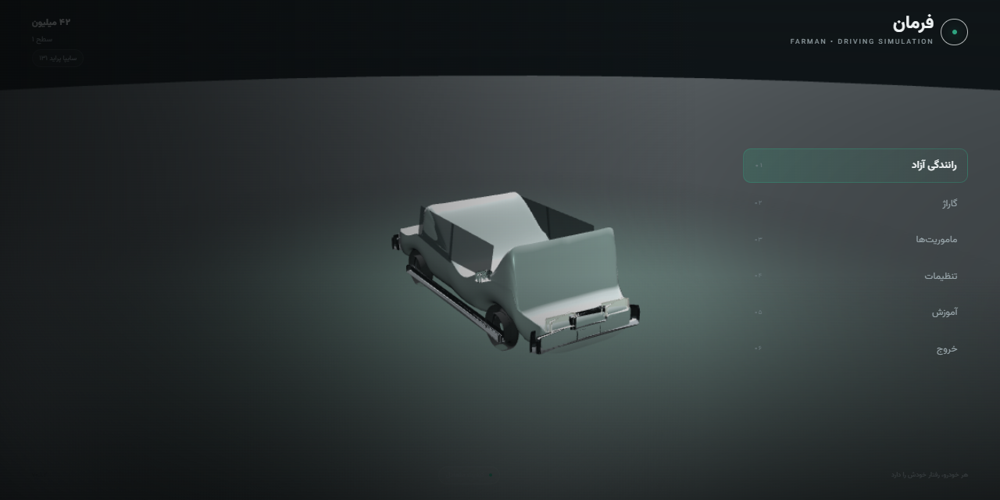
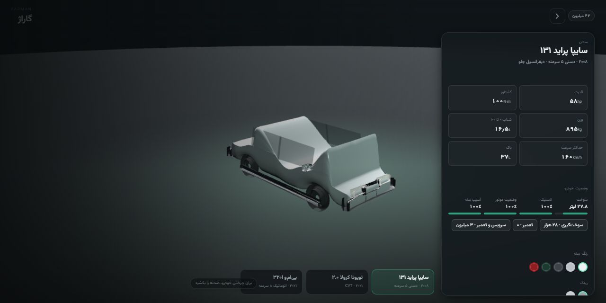
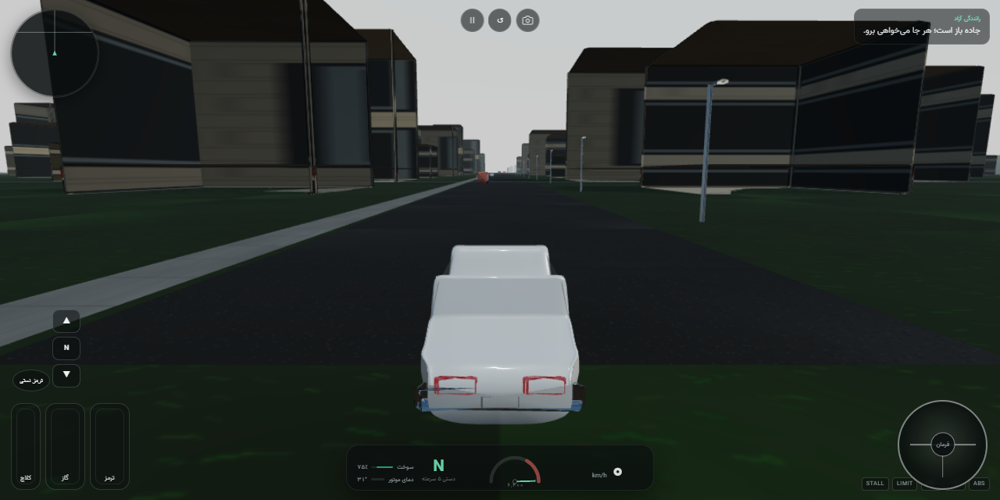
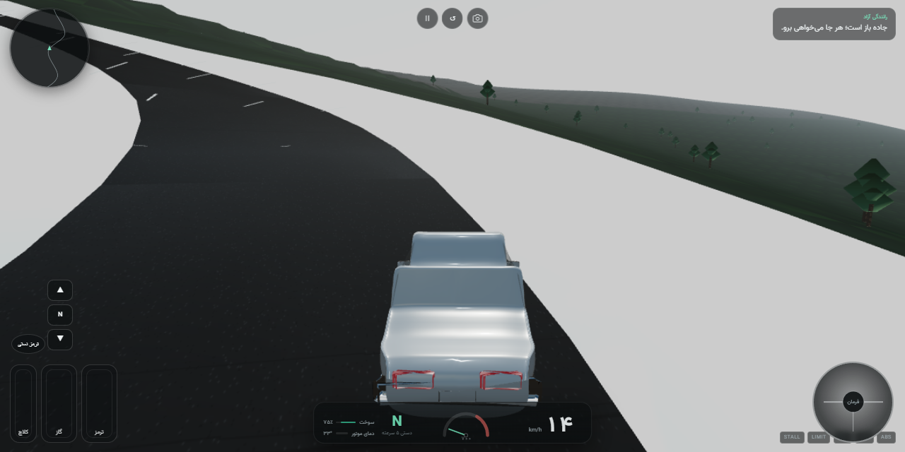
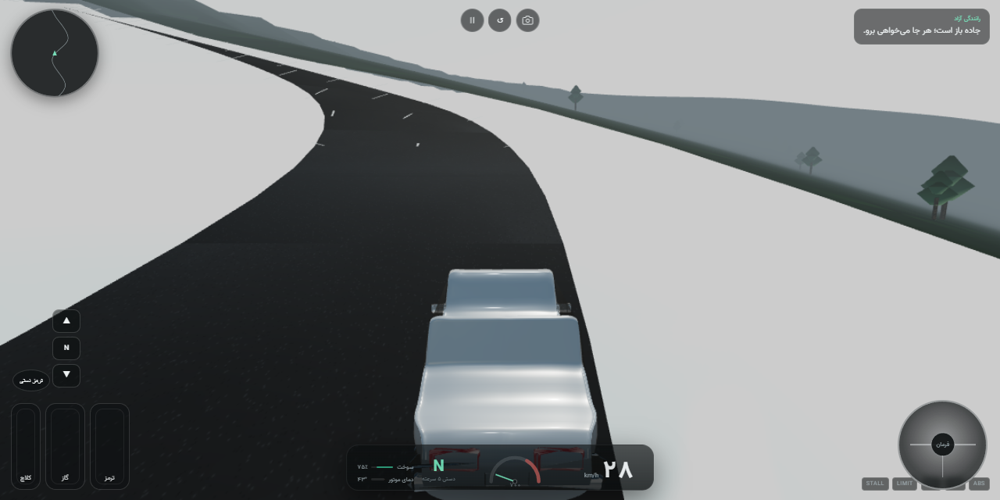
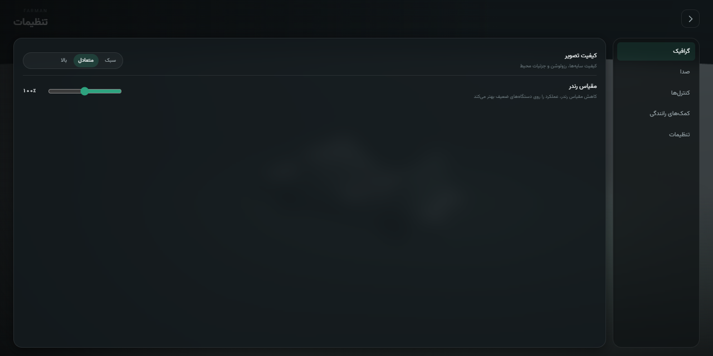

# FARMAN · فرمان

[](https://github.com/khiyarusa/farman/actions/workflows/ci.yml)
[](https://github.com/khiyarusa/farman/actions/workflows/android.yml)

> **Download:** [FARMAN v0.1.3 debug APK](https://github.com/khiyarusa/farman/releases/tag/v0.1.3) · preview build, debug-signed.

**Persian-first, offline-first Android driving simulation.** One connected region, three
cars that do not drive alike, and a UI written in Persian rather than translated into it.

> **هر خودرو، رفتار خودش را دارد**  
> *Every car behaves differently.*

FARMAN is a single-player driving game for Android, wrapped with Capacitor and rendered with
Babylon.js. It runs entirely from bundled assets: no account, no network calls and no remote
content. A 1.3-litre front-wheel-drive manual, a belt-CVT family sedan and a rear-drive turbo
sedan share one physics model but not one personality — clutch bite, converter lock-up and
CVT ratio behaviour are modelled separately.

---

## Status — V1 vertical slice (v0.1.0 preview)

`APP.version = 0.1.0` · build tag `v0.1.0-dev` · 2026-11-12 · **preview, debug APK only**

| Area | State |
|---|---|
| Vehicles | **3 drivable cars** — Saipa Pride 131 (5-speed manual, FWD), Toyota Corolla 2.0 CVT (FWD), BMW 320i G20 (8-speed automatic, RWD) |
| World | **One connected region**, 3.6 km × 3.6 km, 11 named roads: city grid, dual-carriageway highway, mountain pass, rural/Caspian village |
| Traffic | 10–24 lane-following agents with kinematic colliders; they keep headway and brake for the player |
| Missions | **7 missions** — parking, hill start, traffic, emergency braking, wet road, time trial, eco driving |
| UI | **Persian RTL** throughout (`lang="fa" dir="rtl"`), bundled Vazirmatn, Persian digits and separators |
| Saves | **Local only** — versioned JSON in `localStorage`, validated and repaired on load |
| Android | Capacitor 8.6 shell, `minSdk 24`, `targetSdk 36`, landscape; the **debug APK is assembled by CI** |
| Audio | Procedural Web Audio: per-vehicle engine note from firing frequency + load, tyre slip noise, wind, rain, UI clicks; four volume buses wired to settings |

This is a vertical slice, not a store release. The full scope and the explicit non-goals are
in [`GDD.md`](GDD.md) §5; architecture and known limits are in [`TDD.md`](TDD.md).

---

## Screenshots

Captures are produced by the visual QA pass and committed under
`docs/visual-qa/v0.1.0/screenshots/`. The paths below are the release paths; the folder is
populated by that pass, so the images may be absent in a source checkout that predates it.
See [`docs/visual-qa/INDEX.md`](docs/visual-qa/INDEX.md) for the capture recipe.

| Preview | File (relative to this README) | Caption |
|---|---|---|
|  | `docs/visual-qa/v0.1.0/screenshots/01-menu.png` | Main menu — free drive, garage, missions, settings, help and exit. |
|  | `docs/visual-qa/v0.1.0/screenshots/02-garage.png` | Garage — car selection, specifications, service, paint and rims. |
|  | `docs/visual-qa/v0.1.0/screenshots/07-driving-manual.png` | City drive — manual gearbox HUD while driving the city street. |
|  | `docs/visual-qa/v0.1.0/screenshots/09-mountain.png` | Mountain pass — the Alborz-style route. |
|  | `docs/visual-qa/v0.1.0/screenshots/10-rain.png` | Rain — the wet-road mission in the mountain weather preset. |
|  | `docs/visual-qa/v0.1.0/screenshots/05-settings.png` | Settings — graphics, audio, controls, assists and interface. |

---

## Requirements

| Tool | Version | Needed for |
|---|---|---|
| Node.js | **≥ 22.12** (`package.json` `engines`) | every npm script |
| npm | 10+ (lockfile v3 is committed) | install and scripts |
| Python | **3.11+** | regenerating assets only |
| Python packages | `numpy`, `pillow`, `arabic-reshaper`, `python-bidi` | Persian sign textures and image generation |
| Android SDK + JDK 21 | API 36 / Temurin 21 | assembling the APK locally (CI has both) |

The web app itself has no Python or Android dependency. A desktop browser is the fastest
way to develop; the Android WebView is the target.

---

## Run the web build

```bash
npm install
npm run dev          # Vite on http://127.0.0.1:5188 (strict port)
```

Open `http://127.0.0.1:5188/`. WebGL2 is required — the boot screen fails fast with a
Persian error if the browser cannot provide it.

### Regenerating assets (optional)

Every GLB, texture, sky map and `world.json` is generated by the Python scripts in
`tools/assetgen/`. The committed outputs are enough to play; regeneration is only needed
when you change a generator.

```bash
python -m pip install numpy pillow arabic-reshaper python-bidi
npm run assets
```

`npm run assets` targets `tools/assetgen/build_all.py`. That one-shot entry point is not
present in the current tree, so run the generators directly until it lands:

```bash
python tools/assetgen/vehicles.py    # car + traffic GLBs
python tools/assetgen/world.py       # terrain, roads, props, vegetation, world.json
python tools/assetgen/textures.py    # surface/facade/sign textures
python tools/assetgen/sky.py         # sky-day / sky-dusk / sky-rain
```

The generators are deterministic (fixed seeds), write into `public/assets/`, and require
no Blender and no third-party model files.

---

## Build

### Web bundle

```bash
npm run build        # typecheck + vite build -> dist/
npm run preview      # serve dist/ on http://127.0.0.1:4173
```

`vite.config.ts` sets `base: './'` so the Capacitor shell can load the bundle from its local
origin, and splits Babylon and Rapier into separate chunks.

### Android APK

The Capacitor project lives in `android/`. If it is missing in your checkout, create it once
with `npm run android:add`; otherwise sync the current web build and assemble:

```bash
npm run build
npx cap sync android
cd android
./gradlew assembleDebug          # Windows: gradlew.bat assembleDebug
```

The APK is written to:

```
android/app/build/outputs/apk/debug/app-debug.apk
```

`android/variables.gradle` pins `minSdkVersion 24`, `compileSdkVersion 36` and
`targetSdkVersion 36`; the manifest locks `sensorLandscape`. The debug APK is not signed for release and is the only installable artifact this project
currently produces — see the signing policy in
[`docs/release/RELEASE_CHECKLIST.md`](docs/release/RELEASE_CHECKLIST.md).

**CI:** three GitHub Actions workflows drive the release path — `ci.yml` (typecheck, lint,
tests, web build and a no-remote-dependency check), `android.yml` (debug APK plus an unsigned
release AAB, with `SHA256SUMS.txt`) and `release.yml` (tagged preview releases carrying the
debug APK and its checksums). The authoring machine has no Android SDK, so `gradlew` is not
run locally; attach the `Android` workflow run URL and the APK digest to the release
checklist for every build.

---

## Controls

### Touch

| Control | How it works |
|---|---|
| Steering | Drag the on-screen wheel around its centre (default). Settings also offer ◀ / ▶ buttons and gyro steering. |
| Throttle / brake | Analog pedals: the touch point's vertical position inside the pedal sets travel, 0 at the bottom to 1 at the top. Multi-touch is tracked per pointer. |
| Clutch | Third pedal, manual cars only. A manual shift is refused unless the clutch is at least 55 % pressed. |
| Gearbox (manual) | ▲ / N / ▼ buttons. Reverse is refused above 1.4 m/s. |
| Gearbox (automatic) | One selector cycling P → R → N → D. Reverse is refused above 1.5 m/s. |
| Handbrake | Hold the button; rear torque plus reduced rear lateral grip. |
| Camera / reset / pause | Top icon buttons. Reset returns to the mission or free-drive spawn. |

### Keyboard (desktop development and QA)

| Key | Action |
|---|---|
| `W` / `↑` | Throttle |
| `S` / `↓` | Brake |
| `A` `D` / `←` `→` | Steer |
| `Ctrl` / `Shift` | Clutch |
| `Space` | Handbrake |
| `E` / `Q` | Shift up / down |
| `M` | Gear selector |
| `C` | Cycle camera (chase → close → hood) |
| `R` | Reset the car to the spawn |
| `P` / `Esc` | Pause |

> **Known defect:** keyboard left steering (`A` / `←`) is clamped to zero in
> `src/input/keyboard.ts`; right steering and the pedals work. Touch steering is unaffected.
> Tracked in [`TDD.md`](TDD.md) §13.

---

## Vehicles

All three are unlocked in the default save. Power is computed from the in-game torque curve
by `peakPowerHp()` in `src/ui/screens/garage.ts`, so it can differ by a few horsepower from a
manufacturer brochure. Every profile is marked `dataConfidence: 'estimated'`; the values are
the game's own engineering data, not manufacturer claims.

| Model | Persian name | Engine | Power | Torque | Gearbox | Drive | 0–100 | Top speed |
|---|---|---|---|---|---|---|---|---|
| Saipa Pride 131 LX (2008) | سایپا پراید ۱۳۱ | 1.323 L NA I4 | **58 hp** | **100 N·m** @ 3000 | 5-speed manual | **FWD** | 16.5 s | 160 km/h |
| Toyota Corolla 2.0 LE (E210, 2021) | تویوتا کرولا ۲.۰ | 1.987 L NA I4 | **152 hp** | **205 N·m** @ 4400 | **CVT** (belt) | **FWD** | 7.5 s | 195 km/h |
| BMW 320i G20 (2021) | بی‌ام‌و ۳۲۰i | 1.998 L turbo I4 | **205 hp** | **300 N·m** @ 1350–4000 | **8-speed torque-converter automatic** | **RWD** | 7.1 s | 240 km/h |

What that means behind the wheel:

- **Pride** — no ABS/TCS/ESC. It stalls if you release the clutch under load, needs the clutch
  for every shift, and has the weakest brakes and narrowest tyres.
- **Corolla** — a belt CVT, not a stepped automatic: the ratio sweeps between 2.48 and 0.4
  instead of pausing on shifts. ABS, TCS and ESC are on by default.
- **BMW** — torque converter with a 2.05 stall ratio, lock-up above 0.86 speed ratio, eight
  ratios and rear-wheel drive. It is the only rear-drive car in the slice, so its limit
  behaviour is the one that differs most from the two front-drive cars.

Each car has five paint colours and two rim sets with Persian names, priced in the garage.

---

## Project layout

```
src/
  core/          config, fixed-step loop, math, seeded RNG, event bus
  physics/       Rapier world wrapper: heightfield, trimesh, boxes, bodies
  vehicles/      profile schema, engine, transmission, tyres, chassis simulation
  world/         surface kinds and the SurfaceProvider interface
  traffic/       lane-following agents and their kinematic colliders
  missions/      mission definitions and per-kind evaluation/scoring
  rendering/     Babylon scenes, camera rig, environment, vehicle view
  input/         touch controls (wheel/buttons/gyro, pedals) and keyboard fallback
  ui/            RTL design system, screens, HUD, Persian strings, formatting
  save/          versioned schema, validation/repair, debounced storage
  app.ts         orchestrator: screens, drive lifecycle, economy, settings
  main.ts        boot, WebGL2 gate, fatal error UI, window.__farman QA handle
tools/
  assetgen/      Python generators for every GLB/PNG/world file (no Blender)
  qa/            Playwright smoke captures, telemetry probes, image checks
public/assets/   generated models, textures, sky maps, world data, Vazirmatn fonts
tests/           Vitest unit tests (physics, save schema, localization)
android/         Capacitor Android project (gradle wrapper, manifest, resources)
docs/            research, release, QA and visual-QA evidence
.agents/skills/  vendored game-dev notes and the Babylon.js guide (not shipped)
```

Architecture boundaries are enforced by convention and documented in
[`AGENTS.md`](AGENTS.md) §3: simulation modules do not import Babylon or touch the DOM.

---

## Testing and QA

```bash
npm run typecheck        # tsc --noEmit
npm run test             # vitest run (tests/**/*.test.ts)
npm run test:watch       # vitest in watch mode
npm run lint             # eslint .
npm run build            # typecheck + production bundle
npm run dev              # needed before the Playwright scripts
```

Current baseline at the time of writing (2026-11-12): `typecheck` passes, `build` passes
(900 modules), and `test` passes **24/24** across `tests/localization.test.ts` and
`tests/unit.test.ts`. Do not treat those numbers as permanent; record the run in the release
checklist.

Playwright scripts use the installed Edge channel with ANGLE/D3D11, a 1280 × 640 viewport,
and the `window.__farman` debug handle:

```bash
node tools/qa/smoke.mjs         # menu -> drive, saves PNGs, dumps debugState
node tools/qa/garage-shot.mjs   # menu -> garage, plus a rotated view
node tools/qa/debug-drive.mjs   # drives with keyboard and prints telemetry
node tools/qa/physics-probe.mjs # standalone Rapier suspension probe (no browser)
python tools/qa/img-check.py    # luminance bands of the generated sky maps
```

`FARMAN_URL` overrides the target URL and `FARMAN_SHOTS` the output directory (default
`docs/visual-qa/dev`, which is gitignored). `npm run shots` currently points at
`tools/qa/capture.mjs`, which is not in the tree — use `smoke.mjs` until that script lands.

---

## Documentation

| Document | What it covers |
|---|---|
| [`GDD.md`](GDD.md) | Player-facing design: pillars, scope, controls, missions, economy, weather, HUD, design gaps |
| [`TDD.md`](TDD.md) | Architecture, physics model, Rapier findings, save format, asset pipeline, performance limits, known defects |
| [`AGENTS.md`](AGENTS.md) | Engineering contract: invariants, boundaries, verification, change recipes |
| [`ART_BIBLE.md`](ART_BIBLE.md) | Palette, typography, lighting, vehicle/environment art rules and honest visual shortcomings |
| [`ASSET_LICENSES.md`](ASSET_LICENSES.md) | Provenance and licences for every asset family, plus trademark status |
| [`VEHICLE_DATA_SOURCES.md`](VEHICLE_DATA_SOURCES.md) | Per-car values, verified vs estimated, and divergences from the research record |
| [`TECHNICAL_IMPLEMENTATION_PLAN.md`](TECHNICAL_IMPLEMENTATION_PLAN.md) | Implementation audit and priority order for the remaining work |
| [`docs/qa/TEST_PLAN.md`](docs/qa/TEST_PLAN.md) | Test strategy, expected values and the manual Android checklist |
| [`docs/qa/SKILL_AND_TOOL_USAGE.md`](docs/qa/SKILL_AND_TOOL_USAGE.md) | Audit of the skills and tools actually used while building this slice |
| [`docs/release/RELEASE_CHECKLIST.md`](docs/release/RELEASE_CHECKLIST.md) | Release gates, evidence to attach, signing policy |
| [`docs/release/RELEASE_NOTES_v0.1.0.md`](docs/release/RELEASE_NOTES_v0.1.0.md) | Draft notes for the v0.1.0 preview |
| [`docs/visual-qa/INDEX.md`](docs/visual-qa/INDEX.md) | Visual evidence folder structure, capture names and report template |
| [`docs/research/`](docs/research/) | Dated research inputs: stack/Rapier API, Persian UI and Iranian roads, vehicle data, skills audit |
| [`.agents/skills/gamedev/README.md`](.agents/skills/gamedev/README.md) | How to use the vendored game-dev skills; [`SOURCE.md`](.agents/skills/gamedev/SOURCE.md) has upstream SHAs and licences |
| [`.agents/skills/babylonjs/README.md`](.agents/skills/babylonjs/README.md) | Project-authored Babylon.js 8 notes: deep imports, PBR, GLB, shadows, mobile budgets |

---

## Licence and asset status

- **Code:** `"license": "UNLICENSED"` in `package.json`. This repository does not grant an
  open-source licence; all rights are reserved unless a separate written licence says
  otherwise.
- **Art, models, textures, sky maps, world data:** generated by `tools/assetgen/*.py` from
  parametric code and fixed seeds. Original work, no third-party meshes, textures or
  photographs. The GLB writer (`tools/assetgen/glb.py`) is project code, not a vendored
  library.
- **Font:** Vazirmatn 33.0.3, SIL Open Font License 1.1, bundled unmodified. The OFL text and
  authors file are **not yet copied into `public/`** — a release blocker recorded in
  [`ASSET_LICENSES.md`](ASSET_LICENSES.md) §2.
- **Runtime dependencies:** Babylon.js and Rapier are Apache-2.0; Capacitor, Vite, Vitest and
  ESLint are MIT. Licence texts must travel with a distribution.
- **Vendored skills:** `.agents/skills/gamedev/` is Apache-2.0 material copied verbatim from
  two upstream repositories; the licence and NOTICE files live in
  `.agents/skills/gamedev/LICENSES/`. None of it is shipped in the APK. See
  [`SOURCE.md`](.agents/skills/gamedev/SOURCE.md).
- **Trademarks:** the game names real vehicles descriptively. No manufacturer logos, badges
  or wordmarks are modelled. **No trademark clearance or legal review has been done**; this
  must be resolved before any store release ([`ASSET_LICENSES.md`](ASSET_LICENSES.md) §6).

---

## Known limitations

Candid list for this slice — these are shipped behaviour, not a wish list.

- **Procedural low-poly vehicles.** Bodies are lofted, hard-edged approximations with no
  shutlines, badges, interiors, underbody or wheel wells. At chase distance they read as the
  right silhouette, not as the real car.
- **No traffic lights.** Intersections are unmanaged. Traffic follows lanes, keeps headway
  and brakes for the player; it has no signals, stop signs or right-of-way rules.
- **No cockpit interiors.** Cameras are chase, close and hood only. `visual.cockpitEye` is
  authored in every profile but never read, and there is no interior mesh.
- **No damage deformation.** `bodyDamage` is a single 0–1 scalar used for scoring and repair
  cost. No panels detach, no glass breaks and the mesh never deforms.
- **Performance on a real Galaxy A23 has not been measured.** No frame-time, draw-call, GPU
  memory or thermal data exists yet. The quality presets are budgets, not measurements; see
  [`TDD.md`](TDD.md) §12.
- **Sky and horizon wash out.** The gradient sky dome collapses to a near-white band at the
  horizon; there are no structured clouds, atmospheric layers or sun disc. Rain is a fog and
  grip change, not droplets or spray.
- **The save is local-only.** Progress lives in `localStorage` inside the WebView: no cloud
  sync, no account, no export. Writes are debounced 400 ms and there is no flush on a hard
  kill, so the last change can be lost if the process dies inside that window. Corrupt JSON
  is copied to a backup key and defaults are loaded.
- **Drive state is not written back.** Fuel burn, tyre wear, engine wear, damage and odometer
  are simulated during a drive but are not persisted when you leave it; the garage shows
  pre-drive values. Refuel and repair are therefore mostly cosmetic in this slice.
- **Audio is synthesised, not recorded.** Convincing, continuous and load-reactive,
  but it is a synth rather than a sampled engine, and there is no music.
- **Three settings are inert.** Steering sensitivity, control size and control opacity are
  stored and persist, but the control layer does not consume them yet.
- **Keyboard left steering is dead** (QA/desktop only; touch is unaffected) — see the controls
  note above.
- **Android artifact is a debug APK.** It is not signed for release and not Play-ready; see
  the signing policy in the release checklist.

Fixes for the visual items are ordered in [`ART_BIBLE.md`](ART_BIBLE.md) §9; functional gaps
are listed in [`GDD.md`](GDD.md) §5.2 and §14.
